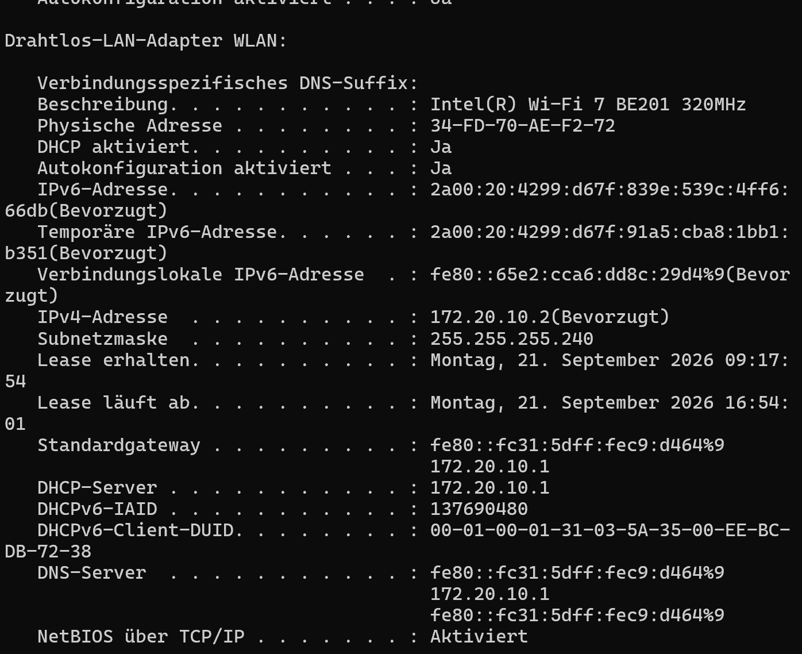
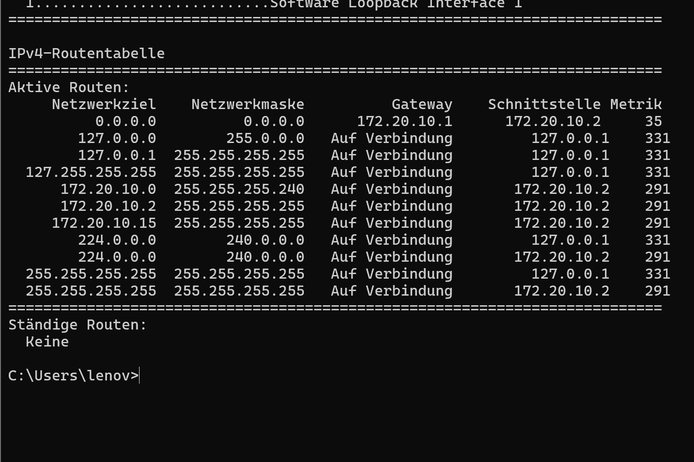
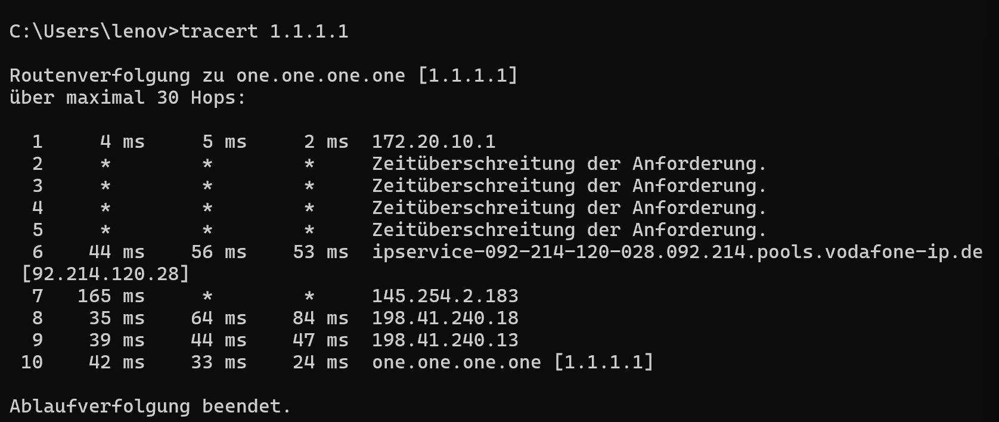
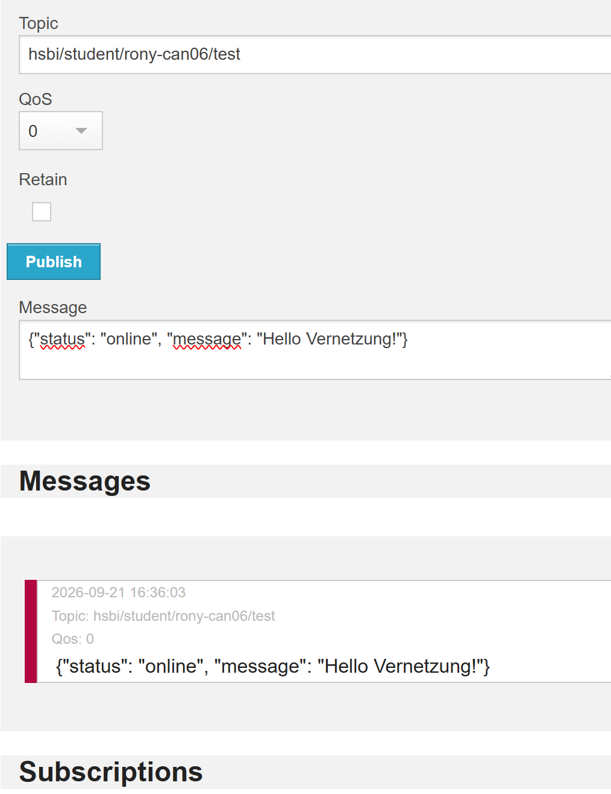

### 1. Meine IoT-Idee: Nachtbeleuchtung im Pflegeheim

Im Video fand ich die Hausautomation im Pflegeheim besonders interessant, weil man damit Menschen im Alltag helfen kann.

Eine mögliche Umsetzung wäre eine automatische Nachtbeleuchtung. Ein Bewegungssensor erkennt, wenn ein Bewohner nachts aufsteht. Ein Helligkeitssensor prüft zusätzlich, ob es dunkel ist. Wenn beide Bedingungen erfüllt sind, schaltet eine lokale Steuerung eine dezente Beleuchtung ein. Das könnte den Bewohnern helfen, sich nachts besser zu orientieren, ohne selbst einen Lichtschalter suchen zu müssen.

Die Bewegungs- und Helligkeitssensoren müssten ihre Messwerte über das lokale Netzwerk an die Steuerung senden. Diese würde anschließend einen Schaltbefehl an die Beleuchtung übertragen. Die Funktion sollte auch ohne Internetverbindung verfügbar sein.

### 2. IP-Adresse und Subnetzmaske

Eine IP-Adresse adressiert eine Netzwerkschnittstelle eines Geräts. Die Subnetzmaske legt fest, welcher Teil der IP-Adresse zum Netzwerk gehört und welcher Teil das Gerät innerhalb dieses Netzes bezeichnet.

Bei der Subnetzmaske 255.255.255.0, kurz /24, bilden die ersten drei Zahlenblöcke den Netzanteil. Ein Laptop mit 192.168.10.20/24 und ein Sensor mit 192.168.10.80/24 befinden sich daher im selben Subnetz.

Zwei unterschiedliche Geräte dürfen im selben Subnetz nicht dieselbe IP-Adresse verwenden, weil dadurch ein Adresskonflikt entsteht. Daten können dann beim falschen Gerät ankommen oder die Kommunikation kann ausfallen.

### 3. OSI-Modell und TCP/IP in der Praxis

Das OSI-Modell beschreibt die Netzwerkkommunikation in sieben Schichten. Das TCP/IP-Modell verwendet vier Schichten und passt häufig besser zur praktischen Umsetzung. Die Aufgaben der oberen drei OSI-Schichten hängen eng zusammen und werden oft gemeinsam von einer Anwendung und ihren Bibliotheken übernommen. Deshalb fasst TCP/IP sie in einer Anwendungsschicht zusammen. Die Aufgaben selbst bleiben erhalten.

Die Grenzen zwischen den Schichten sind in der Praxis nicht immer eindeutig. Ein Router verwendet beispielsweise IP-Adressen für die Weiterleitung, kann aber zusätzlich TCP- oder UDP-Ports für Firewallregeln auswerten. Das OSI-Modell hilft dabei, diese unterschiedlichen Funktionen einzuordnen.

Bei IoT-Geräten sind Energie, Rechenleistung und Bandbreite häufig begrenzt. Überträgt ein Sensor nur einen kleinen Messwert, können die zusätzlichen Protokollheader im Verhältnis zu den Nutzdaten groß sein. Unnötige Protokollschichten oder doppelt umgesetzte Funktionen verursachen zusätzlichen Übertragungs- und Verarbeitungsaufwand. Deshalb sollten Protokolle und Funktionen passend zur Aufgabe gewählt werden.

Dieser Aufwand entsteht durch die tatsächlich eingesetzten Protokolle und ihre Umsetzung. Allein die Einteilung in vier statt sieben Schichten macht die Datenübertragung nicht schneller oder sparsamer.

## Praktische Netzwerkuntersuchung

### Lokale Netzwerkkonfiguration

Mit `ipconfig /all` habe ich die Konfiguration meines WLAN-Adapters untersucht:

| Angabe          | Ergebnis                            |
| --------------- | ----------------------------------- |
| IPv4-Adresse    | 172.20.10.2                         |
| Subnetzmaske    | 255.255.255.240 beziehungsweise /28 |
| Subnetz         | 172.20.10.0/28                      |
| Standardgateway | 172.20.10.1                         |
| DHCP-Server     | 172.20.10.1                         |

Die IPv4-Konfiguration wird automatisch über DHCP bezogen. Mein Laptop und das Standardgateway befinden sich im selben Subnetz.

### Routingtabelle

Mit `route print -4` habe ich die IPv4-Routingtabelle angezeigt. Das Subnetz 172.20.10.0/28 ist direkt erreichbar. Für Ziele ohne spezifischere passende Route verwendet mein Laptop die Standardroute über 172.20.10.1.

### Routenverfolgung

Mit `tracert 1.1.1.1` habe ich den Weg zum Ziel untersucht. Das Ziel wurde bei Hop 10 erreicht.

Hop 1 zeigte mein Standardgateway mit der privaten IP-Adresse 172.20.10.1. Die erste sichtbare öffentliche IP-Adresse war 92.214.120.28 bei Hop 6. Da die Hops 2 bis 5 nicht antworteten, konnte ich den genauen Übergang zwischen privaten und öffentlichen Adressen nicht erkennen.

Die Sternchen zeigen ausgebliebene Antworten innerhalb der Wartezeit. Sie bedeuten nicht automatisch, dass keine Pakete weitergeleitet werden. In meiner Messung antworteten spätere Stationen und schließlich das Ziel.

Die drei Zeitangaben pro Hop sind getrennte Messungen der Hin- und Rücklaufzeit zwischen meinem Laptop und der antwortenden Station.

### Screenshots als Nachweise

## Praktischer MQTT-Test

Ich habe den HiveMQ Webclient verwendet und mich mit `mqtt-dashboard.com` über Port `8884` mit aktivierter SSL-Option verbunden.

Zunächst habe ich das Topic `hsbi/student/rony-can06/test` mit QoS 0 abonniert. Anschließend habe ich auf demselben Topic die Nachricht `{"status": "online", "message": "Hello Vernetzung!"}` veröffentlicht. Retain war deaktiviert.

Die Nachricht erschien im Bereich „Messages“. Damit konnte ich nachvollziehen, wie der Broker eine veröffentlichte Nachricht an einen Subscriber mit passendem Abonnement weiterleitet. Mein Browserclient übernahm dabei sowohl die Publisher- als auch die Subscriber-Rolle.

